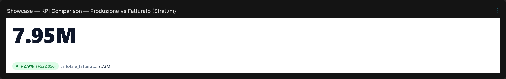
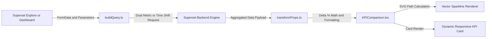

# StratumKPI (KPI Comparison Card) - Benchmark & Delta % Plugin for Apache Superset

[](LICENSE)
[](https://superset.apache.org/)
[](https://www.typescriptlang.org/)
[](https://reactjs.org/)
[](#)

**StratumKPI** (KPI Comparison Card) is a custom visualization plugin for **Apache Superset** that displays an all-in-one, high-impact executive summary card. It combines the primary reference metric, a period-over-period or budget benchmark, the absolute difference, the automated percentage variance ($\Delta\%$), semantic trend badges, color polarity inversion and an integrated vector sparkline.


*Live Dev Studio: interactive workbench with real-time Explore control panel synchronization, typography settings (font family, weight, tabular numbers), cubic Bezier sparklines, inverted polarity and hot module reloading.*

---

## 📸 Visual Preview

### 🖥️ Live Production Dashboard Showcase



*Figure 1: KPI Comparison Card rendered on Apache Superset against a benchmark, with an automated +2.9% (+222,056) delta, a trend indicator and the comparison metric.*

### 🔍 Isolated Component Showcase & Dev Studio


*Figure 2: KPI Comparison Card in the Dev Studio: a +10.8% delta, the Inter font, tabular numbers, a dual delta and a smooth cubic Bezier sparkline.*

<p align="center">
  
</p>

*Figure 3: Close-up view of the rendered KPI Comparison Card component.*

---

## 🌟 Key Features

### 1. 🗂️ All-in-One Compact Executive Card
- **Prominent Primary Value**: the current period or reference metric, shown with high-visibility typography and fluid auto-fitting.
- **Benchmark Comparison Value**: a prior period, budget target or custom baseline, clearly labeled (e.g. `vs Prior Year: 24,500`).
- **Dual Delta Calculations**: computes both the absolute variance ($\text{Ref} - \text{Comp}$) and the percentage variance ($\Delta\% = \frac{\text{Ref} - \text{Comp}}{\text{Comp}} \times 100$).
- **Semantic Trend Badges**: directional indicators (▲ / ▼ / =) with pill, boxed or text styling.

### 2. 🔄 Dual Calculation Engine (Dual Metric vs. Time Shift)
- **Dual Metric Mode (Dataset / Pre-Aggregated SQL)**:
 - Compares two metrics directly from the SQL query or dataset (e.g., `Current Year Requests` vs `Prior Year Requests`, or `Actual` vs `Budget`).
 - Computes instantly with no subquery overhead, which suits pre-aggregated tables.
- **Time Shift Mode (Native Temporal Offset)**:
 - Uses Superset's native temporal offset (`1 year ago`, `1 month ago`, `1 week ago`, `28 days ago`).
 - Queries the historical records automatically and calculates the period comparison on demand.

### 3. 🎯 Color Polarity Inversion ("Lower is Better")
- **Operational Metric Support**: in operations, logistics and cost accounting a decrease can mean an improvement (e.g., waiting times, lead times, cancellation rates, defect rates, operating costs).
- **One-Click Inversion**: when enabled, a reduction is highlighted in **green** and an increase in **red**.

### 4. 📈 High-Resolution SVG Vector Sparkline
- **No Heavy Charting Dependencies**: rendered with lightweight, responsive SVG path math inside the component.
- **Visual Depth**: optional semi-transparent gradient fill beneath the curve, showing the trend and its fluctuations.
- **Chronological Sorting**: driven by a date or time column.

### 5. 🔠 Fluid Typography & Anti-Collapse Layout
- **Dynamic Viewport Scaling**: text scales to fit the card, which prevents a 0px height collapse or awkward wrapping in multi-column dashboards.
- **Header Omission on Micro-Cards**: redundant subtitles are hidden when the card is embedded in very small tiles (under 90px high).

### 6. 🎨 Extensive Aesthetic Customization
- **Background Styling**: full RGBA color picker with alpha transparency.
- **Corner Radius Presets**: `Square (0px)`, `Subtle (8px)`, `Rounded (14px)` and `Pill (24px)`.
- **Card Elevation**: `None (Flat)`, `Subtle Shadow`, `Elevated Shadow` and `Thin Border`.
- **Formatting Support**: d3-format presets, currency symbols (`$`, `€`) and unit suffixes (`%`, `days`, `pts`).

---

## 🏛️ Architecture Overview



---

## 📁 Repository Structure

```
superset-plugin-chart-kpi-comparison/
├── package.json                    # Plugin manifest & dependencies (v0.2.2)
├── tsconfig.json                   # TypeScript build configuration
├── dev.bat                         # Quick launcher for the local Dev Studio
├── dev-studio/                     # Interactive Vite + React HMR workbench
│   ├── index.html                  # Web sandbox with Google Fonts
│   ├── vite.config.ts              # Vite configuration with src aliases
│   └── src/
│       ├── App.tsx                 # Interactive parameter control workbench
│       ├── mockData.ts             # Sample datasets
│       └── supersetMock.ts         # Lightweight Superset Core mock
├── install-plugin.ps1              # Unified PowerShell automated installer
├── install.bat                     # Windows batch launcher
├── src/
│   ├── index.ts                    # Plugin entry point & registration
│   ├── types.ts                    # Component & FormData TypeScript definitions
│   ├── plugin/
│   │   ├── index.ts                # ChartPlugin registration & metadata
│   │   ├── buildQuery.ts           # Query constructor (handles time shift & dual metric)
│   │   ├── controlPanel.tsx        # Superset Explore form controls
│   │   └── transformProps.ts       # Numeric deltas, trend badges & formatting
│   ├── components/
│   │   ├── KPIComparisonChart.tsx  # Main React KPI Card component
│   │   └── KPISparkline.tsx        # Responsive SVG sparkline component
│   ├── utils/
│   │   ├── colors.ts               # Contrast & color calculations
│   │   ├── formatters.ts           # Metric & percentage formatters
│   │   ├── series.ts               # Time series reference extraction
│   │   ├── sparkline.ts            # SVG path & cubic Bezier curve math
│   │   └── trend.ts                # Delta and polarity calculations
│   └── images/
│       ├── thumbnail.png           # Chart picker thumbnail
│       └── example.png             # Full gallery preview image
└── test/                           # Unit tests (191 tests)
```

---

## 🚀 Quick Installation in Apache Superset

### Option 1: Automated PowerShell Script (Recommended)

Run the installer pointing to your Apache Superset repository:

```powershell
powershell -ExecutionPolicy Bypass -File .\install-plugin.ps1 -SupersetPath "D:\Development\superset"
```

For a clean installation that also recompiles the Superset frontend:
```powershell
.\install-plugin.ps1 -SupersetPath "D:\Development\superset" -CleanReinstall -RebuildFrontend
```

The script:
1. Validates and installs the missing npm dependencies (`npm install`).
2. Builds the TypeScript bundle (`tsc --build` / `npm run build`).
3. Syncs the compiled files into `superset-frontend/plugins/superset-plugin-chart-kpi-comparison`.
4. Creates a safety backup `MainPreset.ts.bak`.
5. Registers `KPIComparisonChartPlugin` idempotently under the chart key `kpi_comparison`.
6. Clears the Webpack and Babel caches.

### Option 2: Windows Batch Launcher
Double-click:
👉 **`install.bat`**  
Press `[1]` to start the automated installer.

### Option 3: Manual Installation
1. Copy the plugin folder to `superset-frontend/plugins/superset-plugin-chart-kpi-comparison`.
2. Edit `superset-frontend/src/visualizations/presets/MainPreset.ts`:
   ```typescript
   import { KPIComparisonChartPlugin } from '../../../plugins/superset-plugin-chart-kpi-comparison/src';

   new KPIComparisonChartPlugin().configure({ key: 'kpi_comparison' }).register(),
   ```
3. Clear the cache:
   ```bash
   rm -rf superset-frontend/node_modules/.cache
   ```

---

## 🐳 Docker Compose Deployment

When Superset runs under Docker Compose:

### Non-Dev Environment (Production / Staging)
```bash
cd /path/to/superset
docker compose -f docker-compose-non-dev.yml up -d --build superset
```

### Local Frontend Dev Server
```bash
cd superset-frontend
npm run dev-server
```

Open `http://localhost:8088`, create a new chart and select **KPI Comparison Card**.

---

## 🛠️ Explore Control Panel Reference

| Section | Control (`name`) | UI Label | Type | Default | Description |
|:---|:---|:---|:---|:---|:---|
| **Metrics & comparison** | `calculation_mode` | Calculation mode | Select | `dual_metric` | Comparison mode: `dual_metric` (pre-aggregated SQL) or `time_shift`. |
| | `metric` | Main metric | Metric | (none) | Prominent reference metric (e.g. `SUM(current_visits)`). |
| | `comparison_metric` | Comparison metric (optional) | Metric | (none) | Baseline or target metric in dual metric mode (e.g. `SUM(prior_visits)`). |
| | `time_compare` | Time offset (time shift) | Select | `1 year ago` | Temporal offset (`1 year ago`, `1 month ago`, `1 week ago`, `28 days ago`). |
| | `comparison_label` | Comparison period label | Text | `"vs previous period"` | Descriptive benchmark text (e.g. `"vs 2025"`, `"vs Target"`). |
| | `time_column` | Time column (optional, for the sparkline) | Select | (none) | Date or time column used to order the sparkline. |
| **Card appearance** | `kpi_title` | KPI title | Text | `""` | Top uppercase heading (e.g. `"TOTAL VISITS"`). |
| | `show_title` | Show top title | Checkbox | `true` | Toggles the top title label. |
| | `kpi_subtitle` | Subtitle / detail | Text | `""` | Secondary context line (e.g. `"Department - FY 2026"`). |
| | `card_alignment` | Content alignment | Select | `left` | Text alignment: `left`, `center` or `right`. |
| | `prefix_value` | Value prefix (e.g. €) | Text | `""` | Symbol prepended to the value (`$`, `€`). |
| | `suffix_value` | Value suffix (e.g. %, days) | Text | `""` | Unit appended to the value (`%`, `days`, `hrs`). |
| | `number_format` | Number format | Select | `SMART_NUMBER` | d3-format preset or custom pattern. |
| **Typography & text styling** | `kpi_font_family` | Font family | Select | `inherit` | Font: Inter, Roboto, Montserrat, Poppins, Oswald, JetBrains Mono, Fira Code. |
| | `kpi_font_size_mode` | Main value size mode | Select | `auto` | Responsive automatic scaling (`auto`) or a fixed pixel size (`manual`). |
| | `kpi_font_size_px` | Manual size (px) | Slider | `48` | Font size in manual mode (12-120px). |
| | `kpi_font_weight` | Main value font weight (bold) | Select | `700` | Weight from Light 300 to Black 900. |
| | `kpi_letter_spacing` | Value letter spacing | Select | `normal` | Letter spacing: `tight`, `normal` or `wide`. |
| | `kpi_tabular_nums` | Tabular numeric alignment | Checkbox | `true` | Enables `tabular-nums` so digits have a constant width (no jitter). |
| | `kpi_color` | Main value color | Color | (auto) | Custom color for the main value. |
| | `title_font_size` | Title size | Select | `medium` | Top label size: `small`, `medium`, `large` or `xlarge`. |
| | `title_font_weight` | Title font weight | Select | `600` | Title weight from Regular to Bold. |
| | `title_transform_uppercase` | Uppercase title | Checkbox | `true` | Forces uppercase display. |
| | `title_color` | Title color | Color | (auto) | Color of the card title. |
| | `subtitle_font_size` | Subtitle size | Select | `medium` | Size of the subtitle. |
| | `subtitle_font_weight` | Subtitle font weight | Select | `400` | Weight of the subtitle. |
| | `subtitle_color` | Subtitle color | Color | (auto) | Color of the subtitle. |
| | `comparison_font_size` | Comparison text size | Select | `medium` | Size of the bottom comparison text. |
| | `comparison_font_weight` | Comparison font weight | Select | `400` | Weight of the benchmark row. |
| | `comparison_label_color` | Comparison label color | Color | (auto) | Color of the descriptive comparison text. |
| **Delta % & semantic polarity** | `invert_polarity` | Invert color polarity (lower is better) | Checkbox | `false` | **"Lower is better" mode**: a decrease shows in **green**, an increase in **red**. |
| | `badge_style` | Delta badge style | Select | `pill` | Visual style: `pill`, `full` (solid box) or `subtle` (text). |
| | `show_badge` | Show delta badge | Checkbox | `true` | Shows or hides the percentage badge. |
| | `show_comparison_label` | Show comparison text label | Checkbox | `true` | Shows or hides the descriptive comparison text. |
| | `show_comparison_value` | Show comparison numeric value | Checkbox | `true` | Shows or hides the reference value. |
| | `show_absolute_delta` | Show absolute delta in brackets | Checkbox | `true` | Absolute difference in brackets (e.g. `(+2,640)`). |
| **Card styling** | `card_bg_color` | Card background color | Color | `#ffffff` | Background color with RGBA transparency support. |
| | `card_border_radius` | Corner radius | Select | `subtle` | Corner radius: `square` (0px), `subtle` (8px), `rounded` (14px), `pill` (24px). |
| | `card_box_shadow` | Card shadow / elevation | Select | `none` | Elevation and shadow: `none`, `subtle`, `elevated` or `bordered`. |
| | `card_border_width` | Border width | Select | `0` | Explicit border: `0` (none), `1px`, `2px` or `3px`. |
| | `card_border_color` | Border color | Color | `#e2e8f0` | Color of the outer border. |
| **Sparkline** | `show_sparkline` | Show micro sparkline at the bottom | Checkbox | `false` | Trend curve built into the card. |
| | `sparkline_color` | Sparkline color | Color | `#2563eb` | Color of the SVG line. |
| | `sparkline_fill` | Fill below curve | Checkbox | `true` | Gradient fill beneath the curve. |
| | `sparkline_curve` | Sparkline curve style | Select | `smooth` | Smooth Bezier spline (`smooth`) or angular (`linear`). |
| | `sparkline_show_peak_marker` | Highlight peak | Checkbox | `false` | Marker on the highest point of the series. |
| | `sparkline_show_last_marker` | Highlight current value | Checkbox | `false` | Marker on the latest value in the series. |

---

## 🎨 Dev Studio Locale & Live Preview

The repository includes a standalone **Vite + React HMR** environment for immediate visual checks, without starting a full Superset instance:

```bash
# Quick start on Windows with the batch launcher
.\dev.bat

# Or with the npm script
npm run studio
```

The Dev Studio runs on **`http://localhost:5175/`** and offers:
- **Instant Hot Module Replacement (HMR)**: any change to the components or styles in `src/` shows up in the browser right away.
- **Preconfigured Scenarios**: visit counts, waiting times with inverted polarity, revenue budgets and a dark executive glassmorphism theme.
- **Sliders and Interactive Controls**: real-time adjustment of card width and height, font families, weights, spacing, shadows, sparkline curves and markers.
- **Customizable Canvas Background**: switch between light, dark and executive dark to check contrast and accessibility.

---

## 💻 Local Development & Build

```bash
# Install dependencies
npm install

# Run the test suite (191 tests)
npm test

# Build the ESM bundle and TypeScript declarations
npm run build

# Clean the build output
npm run clean
```

---

## 📄 License

Distributed under the **Apache License 2.0**.
