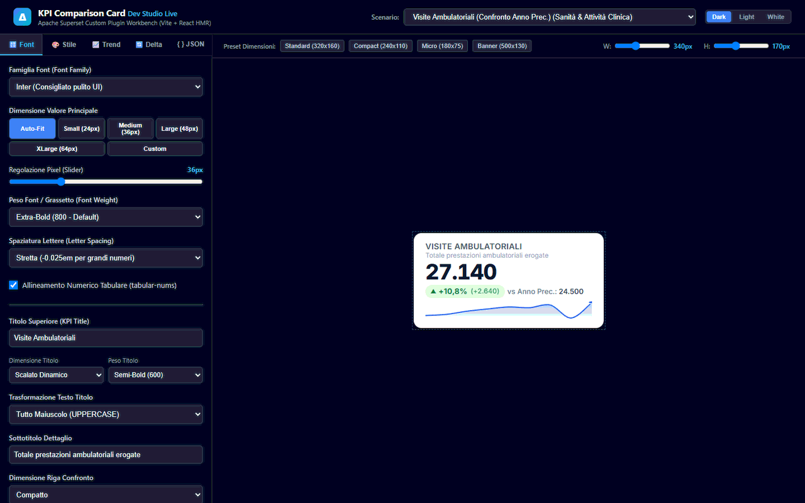
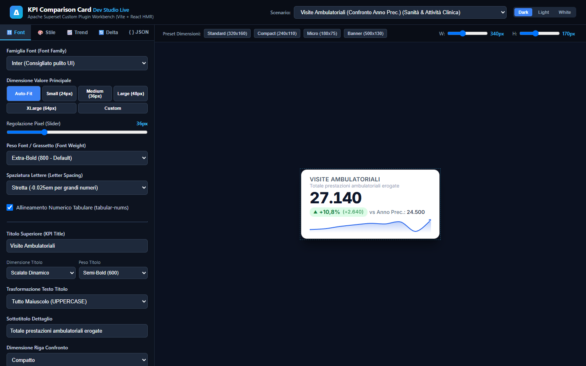
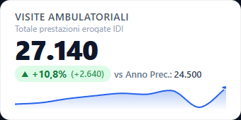
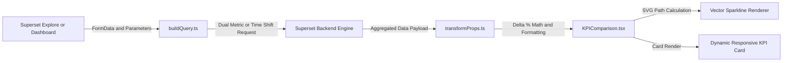

# KPI Comparison Card - Benchmark & Delta % Plugin for Apache Superset

[](LICENSE)
[](https://superset.apache.org/)
[](https://www.typescriptlang.org/)
[](https://reactjs.org/)
[](#)

**KPI Comparison Card** is a custom visualization plugin for **Apache Superset** engineered to display an all-in-one, high-impact executive summary card. It seamlessly combines primary reference metrics, period-over-period or budget benchmarks, absolute difference, automated percentage variance ($\Delta\%$), semantic trend badges, color polarity inversion, and integrated vector sparklines.



*Live Dev Studio: Interactive workbench featuring real-time Explore control panel synchronization, granular typography settings (font family, weight, tabular numbers), cubic Bezier sparklines, inverted polarity, and sub-50ms Hot Module Reloading.*

---

## 📸 Visual Preview



*Figure 1: KPI Comparison Card v0.2.2 Live Showcase: Outpatient clinic volume (+10.8%), Inter font, tabular numbers, dual delta variance, and smooth cubic Bezier sparkline.*

<p align="center">
  
</p>

*Figure 2: Crisp close-up view of the rendered KPI Comparison Card component.*

---

## 🌟 Key Features

### 1. 🗂️ All-in-One Compact Executive Card
- **Prominent Primary Value**: Current period or reference metric displayed with high-visibility typography and fluid auto-fitting.
- **Benchmark Comparison Value**: Prior period, budget target, or custom baseline clearly labeled (e.g. `vs Prior Year: 24,500`).
- **Dual Delta Calculations**: Computes both absolute variance ($\text{Ref} - \text{Comp}$) and percentage variance ($\Delta\% = \frac{\text{Ref} - \text{Comp}}{\text{Comp}} \times 100$).
- **Semantic Trend Badges**: Directional indicators (▲ / ▼ / =) with configurable pill, boxed, or text styling.

### 2. 🔄 Dual Calculation Engine (Dual Metric vs. Time Shift)
- **Dual Metric Mode (Dataset / Pre-Aggregated SQL)**:
 - Compares two metrics directly from the SQL query or dataset (e.g., `Current Year Requests` vs `Prior Year Requests`, or `Actual` vs `Budget`).
 - Delivers instant calculations with zero subquery overhead - ideal for pre-aggregated analytical tables.
- **Time Shift Mode (Native Temporal Offset)**:
 - Leverages Superset's native temporal offset engine (`1 year ago`, `1 month ago`, `1 week ago`, `28 days ago`).
 - Automatically queries historical database records and calculates period comparisons on demand.

### 3. 🎯 Color Polarity Inversion ("Lower is Better")
- **Operational & Clinical Metric Support**: In environments such as healthcare, logistics, and cost accounting, a decrease signifies operational improvement (e.g., patient waiting times, ER door-to-doctor intervals, appointment cancellations, defect rates, operating costs).
- **One-Click Inversion**: When enabled, a reduction is highlighted in **Green** and an increase is flagged in **Red**.

### 4. 📈 High-Resolution SVG Vector Sparkline
- **Zero Heavy Charting Dependencies**: Rendered using lightweight, responsive SVG path math directly inside the component.
- **Visual Depth**: Optional semi-transparent gradient fill beneath the curve highlighting temporal velocity and fluctuations.
- **Chronological Sorting**: Automatically driven by a designated date/time dimension.

### 5. 🔠 Fluid Typography & Anti-Collapse Layout
- **Dynamic Viewport Scaling**: Text scales dynamically to fit card boundaries, completely preventing 0px height collapse or awkward line wrapping on multi-column dashboard layouts.
- **Header Omission on Micro-Cards**: Automatically collapses redundant subtitles when embedded in ultra-compact dashboard tiles (< 90px height).

### 6. 🎨 Extensive Aesthetic Customization
- **Background Styling**: Full RGBA color picker with alpha transparency support.
- **Corner Radius Presets**: `Square (0px)`, `Subtle (8px)`, `Rounded (14px)`, and `Pill (24px)`.
- **Card Elevation**: `None (Flat)`, `Subtle Shadow`, `Elevated Shadow`, and `Thin Border`.
- **Formatting Support**: d3-format string presets, currency symbols (`$`, `€`), and unit suffixes (`%`, `days`, `pts`).

---

## 🏛️ Architecture Overview



---

## 📁 Repository Structure

```
superset-plugin-chart-kpi-comparison/
├── package.json                    # Plugin manifest & dependencies (v0.2.2)
├── tsconfig.json                   # TypeScript build configuration
├── dev.bat                         # Quick launcher for local Dev Studio
├── dev-studio/                     # Interactive Vite + React HMR workbench
│   ├── index.html                  # Web sandbox with Google Fonts
│   ├── vite.config.ts              # Vite configuration with src aliases
│   └── src/
│       ├── App.tsx                 # Interactive parameter control workbench
│       ├── mockData.ts             # Realistic healthcare & business datasets
│       └── supersetMock.ts         # Lightweight Superset Core mock
├── install-plugin.ps1              # Unified PowerShell automated installer
├── install.bat                     # Windows batch menu launcher
├── src/
│   ├── index.ts                    # Plugin entry point & registration
│   ├── types.ts                    # Component & FormData TypeScript definitions
│   ├── plugin/
│   │   ├── index.ts                # ChartPlugin registration & metadata
│   │   ├── buildQuery.ts           # Query constructor (handles time shift & dual metric)
│   │   ├── controlPanel.tsx        # Superset Explore form controls
│   │   └── transformProps.ts       # Numeric deltas, trend badges & formatting
│   ├── components/
│   │   ├── KPIComparisonChart.tsx  # Main React KPI Card component
│   │   └── KPISparkline.tsx        # Responsive SVG sparkline component
│   ├── utils/
│   │   ├── colors.ts               # Contrast & color calculations
│   │   ├── formatters.ts           # Metric & percentage formatters
│   │   ├── series.ts               # Time series reference extraction
│   │   ├── sparkline.ts            # SVG path & cubic Bezier curve math
│   │   └── trend.ts                # Delta and polarity calculations
│   └── images/
│       ├── thumbnail.png           # Chart picker thumbnail
│       └── example.png             # Full gallery preview image
└── test/                           # Unit tests & verification (173 tests)
```

---

## 🚀 Quick Installation in Apache Superset

### Option 1: Automated PowerShell Script (Recommended)

Run the installer pointing to your Apache Superset repository:

```powershell
powershell -ExecutionPolicy Bypass -File .\install-plugin.ps1 -SupersetPath "D:\Sviluppo\superset"
```

To perform a clean installation and trigger a Superset frontend recompile:
```powershell
.\install-plugin.ps1 -SupersetPath "D:\Sviluppo\superset" -CleanReinstall -RebuildFrontend
```

The script autonomously:
1. Validates and installs missing npm dependencies (`npm install`).
2. Builds the TypeScript bundle (`tsc --build` / `npm run build`).
3. Syncs compiled files into `superset-frontend/plugins/superset-plugin-chart-kpi-comparison`.
4. Creates a safety backup `MainPreset.ts.bak`.
5. Idempotently registers `KPIComparisonChartPlugin` under the chart key `kpi_comparison`.
6. Flushes Webpack and Babel bundle caches.

### Option 2: Windows Batch Launcher
Double-click:
👉 **`install.bat`**  
Press `[1]` to launch the automated installer.

### Option 3: Manual Installation
1. Copy the plugin directory to `superset-frontend/plugins/superset-plugin-chart-kpi-comparison`.
2. Edit `superset-frontend/src/visualizations/presets/MainPreset.ts`:
   ```typescript
   import { KPIComparisonChartPlugin } from '../../../plugins/superset-plugin-chart-kpi-comparison/src';

   new KPIComparisonChartPlugin().configure({ key: 'kpi_comparison' }).register(),
   ```
3. Clear the cache:
   ```bash
   rm -rf superset-frontend/node_modules/.cache
   ```

---

## 🐳 Docker Compose Deployment

When managing Superset via Docker Compose:

### Non-Dev Environment (Production / Staging)
```bash
cd /path/to/superset
docker compose -f docker-compose-non-dev.yml up -d --build superset
```

### Local Frontend Dev Server
```bash
cd superset-frontend
npm run dev-server
```

Navigate to `http://localhost:8088`, create a new chart, and select **KPI Comparison Card**!

---

## 🛠️ Explore Control Panel Reference

| Section | Control (`name`) | UI Label | Type | Default | Description |
|:---|:---|:---|:---|:---|:---|
| **Metrics & Comparison** | `calculation_mode` | Calculation Mode | Select | `dual_metric` | Comparison mode: `dual_metric` (pre-aggregated SQL) or `time_shift`. |
| | `metric` | Primary Metric | Metric | (none) | Prominent reference metric (e.g. `SUM(current_visits)`). |
| | `comparison_metric` | Comparison Metric | Metric | (none) | Baseline/target metric when in Dual Metric mode (e.g. `SUM(prior_visits)`). |
| | `time_compare` | Time Shift Offset | Select | `1 year ago` | Temporal offset (`1 year ago`, `1 month ago`, `1 week ago`, `28 days ago`). |
| | `comparison_label` | Comparison Label | Text | `"vs Periodo Prec."` | Descriptive benchmark text (e.g., `"vs 2025"`, `"vs Target"`). |
| | `time_column` | Time Column | Select | (none) | Date/time dimension used to order the vector sparkline. |
| **Card Appearance** | `kpi_title` | KPI Title | Text | `""` | Top uppercase heading (e.g., `"TOTAL OUTPATIENT VISITS"`). |
| | `show_title` | Show Title | Checkbox | `true` | Toggles visibility of top title label. |
| | `kpi_subtitle` | Subtitle / Detail | Text | `""` | Secondary context line (e.g., `"Clinical Department - FY 2026"`). |
| | `card_alignment` | Content Alignment | Select | `left` | Text alignment: `left`, `center`, or `right`. |
| | `prefix_value` | Value Prefix | Text | `""` | Currency symbols (`$`, `€`) prepended to values. |
| | `suffix_value` | Value Suffix | Text | `""` | Units (`%`, `days`, `hrs`) appended to values. |
| | `number_format` | Number Format | Select | `SMART_NUMBER` | d3-format preset or custom formatting pattern. |
| **Tipografia & Testo** | `kpi_font_family` | Famiglia Font Valore | Select | `inherit` | Font: Inter, Roboto, Montserrat, Poppins, Oswald, JetBrains Mono, Fira Code. |
| | `kpi_font_size_mode` | Modalita Dimensione Valore | Select | `auto` | Scaling automatico reattivo (`auto`) o dimensione fissa in pixel (`manual`). |
| | `kpi_font_size_px` | Dimensione Fissa (px) | Slider | `48` | Dimensione del font quando in modalita manuale (12-120px). |
| | `kpi_font_weight` | Peso Font Valore | Select | `700` | Peso tipografico: da Light 300 a Black 900. |
| | `kpi_letter_spacing` | Spaziatura Caratteri | Select | `normal` | Spaziatura testo: `tight`, `normal`, `wide`. |
| | `kpi_tabular_nums` | Allineamento Numeri Tabulare | Checkbox | `true` | Attiva `tabular-nums` per cifre a larghezza costante anti-jitter. |
| | `kpi_color` | Colore Valore KPI | Color | (auto) | Colore personalizzato del valore principale. |
| | `title_font_size` | Dimensione Titolo | Select | `medium` | Dimensione etichetta superiore: `small`, `medium`, `large`, `xlarge`. |
| | `title_font_weight` | Peso Font Titolo | Select | `600` | Spessore del titolo da Regular a Bold. |
| | `title_transform_uppercase` | Titolo Tutto Maiuscolo | Checkbox | `true` | Forza la visualizzazione in maiuscolo. |
| | `title_color` | Colore Titolo | Color | (auto) | Tinta del titolo della card. |
| | `subtitle_font_size` | Dimensione Sottotitolo | Select | `medium` | Scala dimensionale del sottotitolo. |
| | `subtitle_font_weight` | Peso Font Sottotitolo | Select | `400` | Peso del font del sottotitolo. |
| | `subtitle_color` | Colore Sottotitolo | Color | (auto) | Colore del sottotitolo. |
| | `comparison_font_size` | Dimensione Testo Confronto | Select | `medium` | Scala dimensionale del testo di confronto inferiore. |
| | `comparison_font_weight` | Peso Font Confronto | Select | `400` | Peso tipografico della riga di benchmark. |
| | `comparison_label_color` | Colore Etichetta Confronto | Color | (auto) | Colore dedicato alla dicitura descrittiva. |
| **Delta % & Polarity** | `invert_polarity` | Invert Color Polarity | Checkbox | `false` | **"Lower is Better" mode**: decrescita in **Verde**, crescita in **Rosso**. |
| | `badge_style` | Delta Badge Style | Select | `pill` | Stile visivo: `pill` (Pillola), `full` (Box solido), o `subtle` (Testo). |
| | `show_badge` | Show Delta Badge | Checkbox | `true` | Mostra o nasconde il badge percentuale. |
| | `show_comparison_label` | Show Comparison Label | Checkbox | `true` | Mostra o nasconde la dicitura descrittiva del confronto. |
| | `show_comparison_value`| Show Comparison Value | Checkbox | `true` | Mostra o nasconde il valore numerico di riferimento. |
| | `show_absolute_delta` | Show Absolute Delta | Checkbox | `true` | Differenza assoluta tra parentesi (es. `(+2,640)`). |
| **Card Styling** | `card_bg_color` | Card Background Color | Color | `#ffffff` | Colore di sfondo con supporto trasparenza RGBA. |
| | `card_border_radius` | Card Corner Radius | Select | `subtle` | Raggio angoli: `square` (0px), `subtle` (8px), `rounded` (14px), `pill` (24px). |
| | `card_box_shadow` | Card Shadow / Elevation | Select | `none` | Elevazione e ombra: `none`, `subtle`, `elevated`, `bordered`. |
| | `card_border_width` | Spessore Bordo | Select | `0` | Bordo esplicito: `0` (nessuno), `1px`, `2px`, `3px`. |
| | `card_border_color` | Colore Bordo | Color | `#e2e8f0` | Tinta del bordo perimetrale. |
| **Sparkline** | `show_sparkline` | Show Sparkline | Checkbox | `false` | Curva di andamento temporale integrata nella card. |
| | `sparkline_color` | Sparkline Color | Color | `#2563eb` | Colore del tracciato SVG. |
| | `sparkline_fill` | Fill Below Curve | Checkbox | `true` | Sfumatura gradiente sotto la curva. |
| | `sparkline_curve` | Stile Curva | Select | `smooth` | Tracciato morbido spline di Bezier (`smooth`) o angolare (`linear`). |
| | `sparkline_show_peak_marker` | Marker Punto Massimo | Checkbox | `false` | Punto visivo sul picco massimo della serie. |
| | `sparkline_show_last_marker` | Marker Valore Attuale | Checkbox | `false` | Punto visivo sull'ultimo valore temporale rilevato. |

---

## 🎨 Dev Studio Locale & Live Preview

Il repository include un ambiente autonomo **Vite + React HMR** dedicato al collaudo visivo immediato senza dover avviare l'intera istanza Superset:

```bash
# Avvio rapido su Windows tramite launcher batch
.\dev.bat

# Oppure tramite comando npm
npm run studio
```

Il Dev Studio e accessibile su **`http://localhost:5175/`** e offre:
- **Hot Module Replacement (HMR)** istantaneo: qualsiasi modifica ai componenti o agli stili in `src/` si riflette in tempo reale nel browser.
- **Scenari Clinici e Direzionali Preconfigurati**: visite ambulatoriali, tempi di attesa pronto soccorso con polarita invertita, budget ricavi e glassmorphism dark executive.
- **Slider e Controlli Interattivi**: regolazione in tempo reale di larghezza/altezza card, famiglie di font, pesi, spaziature, ombreggiature, curve sparkline e marker.
- **Sfondo Canvas Personalizzabile**: switch immediato tra sfondo chiaro, scuro ed executive dark per verificare contrasto e accessibilita.

---

## 💻 Local Development & Build

```bash
# Installazione dipendenze
npm install

# Esecuzione suite di test (173 test)
npm test

# Compilazione bundle ESM e dichiarazioni TypeScript
npm run build

# Pulizia cartella di compilazione
npm run clean
```

---

## 📄 License

Distributed under the **Apache License 2.0**.
